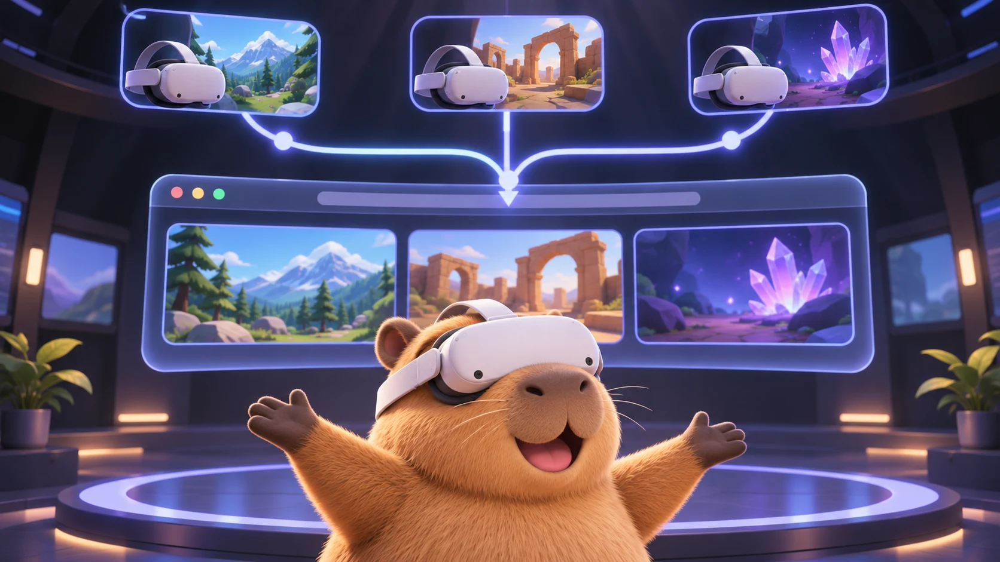
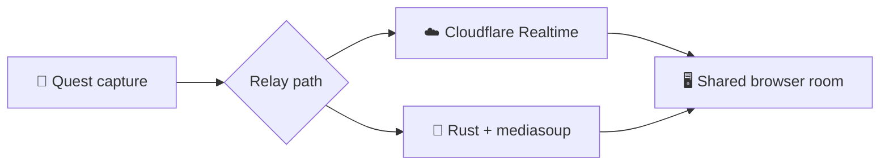

<div align="center">
  <h1>QuestRelay</h1>
  <p><strong>Stream Meta Quest video and supported game audio to a shared browser room</strong></p>
  <p>
    <a href="https://github.com/uqrealitylabs/questrelay/actions/workflows/check.yml"></a>
    <a href="https://github.com/uqrealitylabs/questrelay/actions/workflows/security.yml"></a>
  </p>
  
  <p>
    <a href="https://cast.uqrealitylabs.com"></a>
    <a href="docs/ARCHITECTURE.md"></a>
  </p>
</div>

The headset companion app captures with the wearer's permission, publishes H.264 and Opus, and keeps the publisher key in Android Keystore. Viewers choose feeds and control their own layout and audio; operators manage access, capture and connection diagnostics



## 🚀 Deploy

| | Best for | Start here |
| --- | --- | --- |
| ☁️ **Cloudflare** | Hosted demos without a relay VM | [`docs/CLOUDFLARE.md`](docs/CLOUDFLARE.md) |
| 🐳 **Docker Compose** | A public server or controlled LAN | [`docs/LOCAL.md`](docs/LOCAL.md) |

### Cloudflare

Deploy the Worker and web app, then provision an authorised Quest over USB:

```bash
tools/scripts/deploy.sh cf
tools/scripts/deploy.sh adb devices
tools/scripts/deploy.sh headset YOUR_ADB_ID
```

The first deployment also needs D1, Realtime and Worker secrets. Follow the [Cloudflare guide](docs/CLOUDFLARE.md)

### Docker Compose

```bash
cp tools/config/.env.example .env
chmod 600 .env
# Fill in the domain, relay address and three different 32+ character keys
tools/scripts/deploy.sh dc
```

The same Compose file supports a public server or an HTTPS LAN. The [local and single-host guide](docs/LOCAL.md) covers TLS modes, ports, private LAN certificates, backups and remote releases

## 🛠️ Develop locally

Install Node.js 22+, Rust and the [mediasoup build prerequisites](https://mediasoup.org/documentation/v3/mediasoup/installation/), then run:

```bash
npm ci
export QUESTRELAY_PUBLISH_KEY="$(openssl rand -hex 32)"
export QUESTRELAY_VIEW_KEY="$(openssl rand -hex 32)"
export QUESTRELAY_ADMIN_KEY="$(openssl rand -hex 32)"
npm run dev:server
```

Run `npm run dev:web` in a second terminal and open the address Vite prints. New rooms start private; sign in at `/admin` with the generated admin key to change access

## 🧭 Project map

| Area | Source |
| --- | --- |
| Browser room and operator UI | [`frontend/src`](frontend/src/) |
| Cloudflare Worker and Realtime signalling | [`backend/edge`](backend/edge/) |
| Single-host Rust relay | [`backend/src`](backend/src/) |
| Quest capture and transport | [`quest/app`](quest/app/) and [`quest/transport`](quest/transport/) |
| Deployment | [`tools/config`](tools/config/) and [`tools/scripts`](tools/scripts/) |

## ✅ Check a change

```bash
npm test
npm run build
```

Component-specific checks and toolchain versions are in the [contribution guide](.github/docs/CONTRIBUTING.md)

## 📚 Reference

- [Architecture, trust boundaries and remaining device tests](docs/ARCHITECTURE.md)
- [Cloudflare deployment](docs/CLOUDFLARE.md)
- [Docker, LAN and server deployment](docs/LOCAL.md)
- [Release history](docs/CHANGELOG.md)
- [Security reporting](.github/docs/SECURITY.md)
- [Code of Conduct](.github/docs/CODE_OF_CONDUCT.md)

QuestRelay uses a [custom modified MIT-style licence](LICENSE). Commercial use and AI training require separate permission
