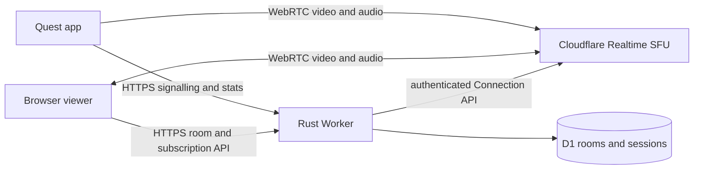

# Run QuestRelay on Cloudflare

The free-hosted path keeps the control API in a Rust Worker and room state in D1. The Quest publishes H.264 video and Opus device audio over WebRTC to Cloudflare Realtime SFU, and each browser subscribes directly to the feeds it watches. No public VM, Docker host or direct media port is needed



## Before the first deploy

You need a Cloudflare account with Workers, D1 and a Serverless SFU app, plus Node.js 22+, Rust with the `wasm32-unknown-unknown` target and `worker-build` 0.8.7 on your build machine

```bash
npm ci
rustup target add wasm32-unknown-unknown
cargo install worker-build --version 0.8.7 --locked
npx wrangler login
npx wrangler d1 create questrelay-edge
```

Put the returned D1 database ID in [`backend/edge/wrangler.toml`](../backend/edge/wrangler.toml). Create a Serverless SFU app in the Cloudflare dashboard and put its **App ID** in the same file as `SFU_APP_ID`. The **App Secret** stays out of Git and is entered through Wrangler

The Cloudflare account is already configured with a D1 database and a Worker named `questrelay`. Its address is `https://cast.uqrealitylabs.com`

## Set the three secrets

From `backend/edge`, enter the SFU App Secret at Wrangler's hidden prompt. Generate different admin and Quest publisher keys, keep a recovery copy in an ignored, owner-readable local file, and enter each at the corresponding prompt

```bash
cd backend/edge
npx wrangler secret put SFU_APP_SECRET
npx wrangler secret put ADMIN_KEY
npx wrangler secret put PUBLISHER_KEY
npx wrangler secret list
```

Keep the publisher key as `QUESTRELAY_PUBLISH_KEY` in the ignored repository `.env` so the headset provisioner can install it securely. Never paste any of these values into an issue, release or chat

## Deploy and check

Run the schema step once for a new D1 database, then use the same script without `--init-db` for future code changes

```bash
tools/scripts/deploy.sh cf --init-db
curl -f https://cast.uqrealitylabs.com/health
```

`/health` returns `503` until all three secrets are present. Once it returns `200`, open `/admin` and sign in with the admin key. The public lounge is at `/`, and each connected headset gets a short `/livestream/<id>` link that an admin can make public or protect with an access code

## Build the Quest app

For a USB development test, install JDK 17+, Go 1.26+, Gradle 9.6 and Android SDK platform 35 with NDK `27.2.12479018`. Set `ANDROID_HOME` and `ANDROID_NDK_HOME`, then run

```bash
tools/scripts/deploy.sh adb devices
tools/scripts/deploy.sh headset YOUR_ADB_ID
```

Repeat `headset` with each Quest's own ADB ID. The command builds and installs the debug app, saves `https://cast.uqrealitylabs.com` and the publisher key from `.env`, then opens the app ready to test. Each headset keeps its generated distinct name. Use **Test relay**, then start sharing and approve the screen and audio capture prompts. A release-channel install without Developer Mode requires a signed APK and Meta distribution approval, which is separate from this USB test

## Free-tier and test limits

[Cloudflare's Realtime pricing](https://developers.cloudflare.com/realtime/sfu/platform/pricing/) includes the first 1,000 GB of combined SFU and TURN egress each month. It is a usage allowance, not a hard stop. Traffic above it is billed, so check Realtime usage in the Cloudflare dashboard and keep this staging deployment limited to planned tests. D1 also has [daily free-plan limits](https://developers.cloudflare.com/d1/platform/pricing/) and stops serving queries when those limits are reached

Two Quest 3 headsets have connected individually to the Worker. Safari received H.264 video and an Opus track during a live test. In Beat Saber, the app encoded about 29–30 fps at both 720p and 1080p with a 60 fps target. A 720p receiver sample showed 0% recent video loss, but that is not a guarantee for later sessions. Choose **720p · performance** in the Quest app when bandwidth is limited, then check **Recent video loss** in the viewer and **Quest uplink loss** in the control room

The Worker currently supports admin-key sign-in, room access, per-headset rooms, media controls and diagnostics. The self-hosted backend's multi-admin passkeys have not yet been ported to the Worker. Audible game audio, simultaneous headset capacity, release-channel installation and glass-to-glass latency still need testing. Cloudflare does not report the Quest's send queue to this app, so the control room shows **Not measured** instead of zero. Audio capture depends on each game allowing Android playback capture

For the single-host Rust relay and its Docker images, see [DEPLOY.md](DEPLOY.md)
